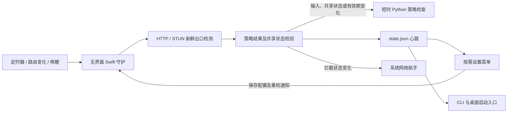

# ClaudeGuard 深度分析与资源优化

日期：2026-11-05。范围：macOS 守护、设置、CLI、共享策略、系统助手、Windows/Linux 实现及已有测试。

## 结论与验收边界

部分完成：源码已支持轻量守护常驻、设置按需打开；隔离真实 HTTPS 样本的主进程达到 CPU＜1%、物理内存＜10 MB；稳定场景的后台合计验收另列。后续用户已授权并完成本机切换；真实后台首轮60秒采样CPU合计0.2386%、物理内存6.768 MB、峰值6.850 MB，状态新鲜。集成后的最终采样另见结果文件。

内存口径必须明确：使用 macOS `sample` 的 **physical footprint**，按十进制 MB 换算；RSS 另列。候选进程 RSS 仍高于 10 MB。用户若要求 RSS＜10 MB，本轮未达标。

“空闲”包含持续出口探测、状态发布、网络事件监听和缓存有效性检查；不包含用户正在打开的设置/警告界面、启动阶段的 Python 策略检查、维修操作或 Claude Code 前台会话包装器。以上瞬时或会话开销不得隐藏为零。

## 架构与开销来源



原版本的基础守护循环已有状态转换去重、网络事件监听、慢检测跳过定时 tick、检查合并和日志轮转。因此，主要浪费集中在 GUI 常驻、每轮网络对象分配、请求扇出、重复 Python 启动、重复菜单生成和持久化，不能简单归因为“用了轮询”。

高级策略的 CLI 目前仍会自行探测，并未完全复用菜单守护结果；图中的共享路径主要覆盖基础白名单模式。详见 R01。

## 测量证据

机器：macOS arm64，Apple Swift 6.4，优化编译 `swiftc -O`。`procmon status` 当时为 STOPPED，历史采样未用作当前状态证据。

| 场景 | CPU | 内存 | 解释 |
|---|---:|---:|---|
| 原安装进程 | 短时 0%、1.9%、0% | `sample` 原始值 23.8M | 实际运行进程；与隔离场景条件不同 |
| 最小 AppKit 菜单原型 | 空闲 0% | 原始值 11.7M | 只有菜单图标，足以说明该常驻原型已超过目标 |
| 原源码、隔离菜单循环 | 25 秒平均 0.664% | 原始值 13.9M | 本地 HTTP，无真实系统拦截 |
| 第一批优化、隔离菜单循环 | 25 秒平均 0.114% | 原始值 12.4M | 同样本地 HTTP 场景 |
| 无界面守护、稳定本地 HTTP | 主进程及子进程合计平均 0.0829% | 当前 5.277 MB；峰值 5.342 MB | 60 秒采样，预热后无策略/维修子进程，稳定态达标 |
| 无界面守护、真实 HTTPS 波动样本 | 60 秒主进程平均 0.5405% | 当前及峰值 7.063 MB；RSS 19.988～21.447 MB | 17 次成功、8 次失败，预热后触发 1 次短时策略进程 |

本地 HTTP 对照中，约 31 秒内服务端收到的请求从 53 次降到 11 次，减少约 79%。正常轮询每次从最多 5 个 HTTP 请求降为 1 个；首选服务慢时，在同一总截止时间内启用其余服务。

真实 HTTPS 波动样本包含一次预热后的短时 Python 重验，因此其严格稳定态检查为 false；没有删除该记录或把它算作“全程无子进程”。该轮没有测得短时 Python 的物理内存峰值，不得据主进程 7.063 MB 宣称所有瞬时进程合计低于 10 MB。

最终机器可读记录：[performance-results.json](performance-results.json)。同时记录当前及峰值 physical footprint、RSS、验证成功/失败的探测次数、预热后的策略/修复子进程启动次数。CPU 由进程 CPU 时间增量除以墙钟时间计算，单核 100% 为基准。

基准程序使用真实守护、网络监听、轮询、HTTP 探测、共享策略桥、策略缓存、锁和状态心跳，但将 `apply`、桌面关闭拦截和维修副作用替换。它不会修改 `/etc/hosts`、pf 或关闭真实 Claude；因此不覆盖生产防护验收。

## 已完成的 16 项优化

| 编号 | 改动 | 证据与影响 |
|---|---|---|
| S01 | 拆出 `--daemon` 无界面入口 | `src/main.swift:1449`；后台不创建 `NSApplication` 或菜单栏窗口 |
| S02 | 设置按需打开，关闭后退出 | `src/main.swift:989`；CLI `settings`、应用包和安装器入口同步更新 |
| S03 | 菜单打开时生成 | `src/main.swift:987`；移除每轮两次菜单重建 |
| S04 | 图标按状态变化更新 | `src/main.swift` 的 `displayedSymbol`；复用已显示图标 |
| S05 | 普通轮询不重启动画 | `stopBlinking`；只有实际闪烁后才执行恢复动画 |
| S06 | HTTP 会话复用且 STUN 不创建 HTTP 会话 | `src/main.swift:574`；代理或截止时间变化时重建；取消 cookie、凭据和响应缓存 |
| S07 | HTTP 首选服务加延迟备用 | `src/main.swift:631`；正常只发一次请求，保留原总截止时间；不复用出口判定 |
| S08 | 释放 STUN 连接回调 | `src/main.swift:725`；失败/取消后断开回调对连接的引用 |
| S09 | 每轮显式释放临时 Objective-C 对象 | `src/main.swift:407` 的 `autoreleasepool` |
| S10 | 缓存稳定的策略事务 | `src/main.swift:1205`；输入、共享状态、评分 TTL、时间倒退均可使缓存失效；新出口检测照常执行 |
| S11 | 策略状态不变时跳过写盘和 fsync | `src/policy.py:164`；首次基线、跳变锁存和评分变更仍持久化 |
| S12 | 维修只在监控对象变化后启动 Python | `src/main.swift:252`；保留每分钟元数据检查；启动失败不缓存成功 |
| S13 | 已配置的有效 CLI 路径直接返回 | `src/integrity.py:120`；避免先枚举 Homebrew、原生版本和 PATH |
| S14 | 减少进程扫描中的重复查询 | `portable/platforms.py:36`；无目标时不扫描，当前用户只查询一次 |
| S15 | 后台单实例锁 | `src/main.swift:189`；独立于 GUI 单实例；锁设为 close-on-exec，避免子进程延续锁生命周期 |
| S16 | 增加可复现的资源验证 | `scripts/benchmark-macos.py`、`tests/test_swift_performance.py`；外加真实 Swift 策略缓存回归 |

HTTP 请求保留 `Connection: close`，用于促使每次出口检测建立新连接。没有把旧连接继续存活或长期缓存公网 IP 当作降耗措施；HTTP/2、代理隧道和 VPN 切换的实际出口仍需生产验证。

S12 的明确限制：首次在常见监控目录及已配置目标之外安装 Claude 时，必须运行 `claudeguard doctor` 触发完整发现。移动或更新已配置目标会改变元数据并触发检查；通用 Spotlight 变更订阅尚未实现。

## 后续对抗性审查更新

本轮源码已修复 R02、R03、R04、R07、R08、R14、R21；R05 的核心检查/自愈并发及设置确认已隔离，未执行 Thread Sanitizer；R06 已共享协议时间预算，但 OS DNS 的真实阻塞时限仍未验证。原行号与下方清单是先前分析快照，当前修复及验证边界以 [对抗性审查](adversarial-review.md) 为准。

本轮 60 秒隔离样本 CPU 合计 0.2396%，physical footprint 5.359 MB、峰值 5.457 MB；RSS 17.924–19.120 MB。130/132 项测试通过、2 项环境跳过。本机运行版本及生产 PF 未被本轮源码修改替换；既有安装与下面的历史测量不可代表新助手已上线。

## 原始优化候选清单（22 项）

P0 为防护正确性或宿主网络影响；P1 为明显资源/一致性开销；P2 为低收益、维护或覆盖率改进。这些条目是本次源码审查识别的完整清单，不声称穷尽未来所有运行场景。

| 编号 | 优先级 | 发现、证据 | 建议与验证条件 |
|---|---|---|---|
| R01 | P1 | 高级策略的每个 CLI 包装器独立检测，`src/brain.py:47`；portable 的守护和启动器也重复检测，`portable/runtime.py:121` | 统一复用带配置指纹、共享状态版本、评分有效期和新鲜度的守护结果；多会话、改配置、跳变及守护死亡必须测试 |
| R02 | P0 | macOS 助手使用全局 `pfctl -f`、`-d`、`-F states`，`src/hosts_helper.c:107`、`:116` | 使用专用 anchor/table 和受控 enable token；实测其他 pf 规则及连接保持完整，不在本轮直接改生产防火墙 |
| R03 | P0 | 调用异步助手前就记录 last-applied，并立即发布 state，`src/main.swift:514` | 分开记录“访问判定”和“系统应用结果”；助手失败/拒绝时重试，不能报规则已应用 |
| R04 | P0 | hosts、pf、request 使用共享暂存路径，`src/network_guard.py:160`、`:267` | 串行提交带版本的完整请求及回执；快速切换时验证最终规则与最新配置一致 |
| R05 | P1 | 后台检查与主线程设置共享可变配置和状态，`src/main.swift:420`、`:1002` | 统一串行队列或不可变快照，验证检测中改规则、代理及开关，覆盖 Thread Sanitizer |
| R06 | P1 | Python HTTP 按服务逐个使用完整 timeout，STUN 也逐个尝试，`src/ip_checker.py:47`、`:72` | 统一整轮截止时间；DNS、连接及读取都纳入预算；坏网下比较响应和误放行边界 |
| R07 | P1 | STUN 解析未严格核对事务 ID、cookie 和声明长度，`src/ip_checker.py:22`、`src/main.swift` 的 `parseStun` | 关联请求与响应、验证协议边界；增加错误事务、截断及伪造包测试 |
| R08 | P1 | Swift 白名单只支持 IPv4 CIDR，Python 支持 IPv6 CIDR，`src/main.swift` 的 `isIPAllowed`、`src/ip_checker.py:114` | 统一 IPv6/CIDR 与地址规范化；双端采用同一判定矩阵 |
| R09 | P1 | 阻断转换会并发启动最多 16 个 DNS 子任务，`src/network_guard.py:129` | 缓存带 TTL 的已验证目标集合并提前准备规则；缓存过期、解析失败及共享 CDN 边界必须保留 |
| R10 | P1 | Linux 助手每 250 ms 启动 nft 查询并遍历 `/proc`，`native/linux_network_helper.py:62`、`:124`、`:164` | 内核事件或 netlink 取代重复子进程；租约失效和进程归组仍及时失败关闭 |
| R11 | P1 | Windows PowerShell 常驻并执行 4 Hz 循环，`native/windows_network_helper.ps1:45` | 将已有 C# WFP 适配器做成原生服务，实测原生进程内存后再承诺 Windows＜10 MB |
| R12 | P1 | Windows/Linux 助手每 250 ms 重写完整状态文件 | 将规则应用、归组确认和心跳分开；维持客户端 4 秒新鲜度及启动握手延迟 |
| R13 | P1 | 每个 Claude Code 会话保留 Python 包装器，`src/cli_wrapper.py:139` | 使用轻量原生监控器或守护注册；必须保留终端恢复、信号、子进程清理和会话隔离 |
| R14 | P1 | 公共 IP 响应缺少严格字节上限，`src/main.swift:631`、`src/ip_checker.py:72` | 在接收过程中限制响应尺寸；大响应不能使守护突破内存目标，错误必须拒绝 |
| R15 | P2 | 网络观察匹配 Interface/Service 的广泛变化，`src/main.swift:319` | 合并同一波事件并限制感兴趣键；保留检查期间的新事件及唤醒重检 |
| R16 | P2 | 常驻计时器未设置 tolerance，`src/main.swift:225`、维修定时器 | 只合并不影响安全时限的维护定时器；不能用延长出口检查间隔换取达标 |
| R17 | P2 | 探测连续失败时每轮写诊断日志、创建格式化器，`src/main.swift` 的 `logEvent`、`probe_failed` | 按错误变化记录并汇总次数，保留首次、恢复及关键错误；验证日志上限 |
| R18 | P2 | Python 单协议检测仍创建线程池，`src/ip_checker.py:145`、`src/policy.py:124` | 单协议直接调用，双协议再并行；比较 HTTP/STUN/both 的判定矩阵 |
| R19 | P2 | 基础 state.json 每轮格式化、原子替换，`src/main.swift:481` | 保留心跳新鲜度；评估紧凑 JSON 或独立心跳，不得直接改成“状态不变就不发布” |
| R20 | P2 | 修复监控依赖有限目录指纹，`src/main.swift:252` | 增加 Spotlight/文件变更事件，覆盖任意安装位置；目前使用明确的 doctor 手动补偿 |
| R21 | P2 | 设置和警告路径仍调用 osascript、同步等待进程，`src/main.swift` 的模型和 IP 编辑动作 | 复用原生控件并异步处理；收益主要是响应性，按需 UI 已移出常驻预算 |
| R22 | P1 | 缺少跨平台持续资源预算与真实网络故障测试 | 增加长时运行、断网/VPN/代理切换、风险查询失败、活跃多 CLI 会话和系统助手的峰值预算 |

R02、R03、R04 的源码修复和隔离反例已在后续审查完成；生产 PF 端到端与旧全局规则迁移仍未验证。P0 不得被 CPU/内存达标掩盖。

## 验证与复现

已验证：106 项 unittest，104 项通过、2 项跳过（含集成回归）。跳过原因为本机 Python 未安装 Tk，以及 Windows 注册表测试不适用于 macOS。

新增或扩展验证覆盖：HTTP 模式隔离、会话复用、代理切换、首选服务超时后的备用、错误状态/非法 IP 拒绝、正常请求数、评分 TTL、整数 TTL、共享状态修改、跳变锁存、时间倒退、单实例锁、锁的继承边界、维修失败重试、稳定状态不写盘和无目标不扫描。

```bash
python3 -m unittest discover -s tests -v
swiftc -O src/main.swift -o /tmp/ClaudeGuardMenuBar-check
bash -n install.sh uninstall.sh scripts/install-linux.sh scripts/uninstall-linux.sh
clang -Wall -Wextra -fsyntax-only src/hosts_helper.c
git diff --check
python3 scripts/benchmark-macos.py --seconds 60
python3 scripts/benchmark-macos.py --seconds 60 --live-http
```

Python 需要 `portable/requirements.txt` 中已有的 psutil。本轮在临时 venv 安装依赖；默认系统 Python 缺少 psutil 导致的最初失败，不代表产品回归。源码没有新增依赖。

未验证：设置菜单真实交互与自动关闭、跨进程重检通知、真实 Desktop 关闭、生产 pf 完整应用、长时间内存趋势、Windows WFP/Linux 内核集成和活跃 CLI 会话的合计资源。后台已实际重启并发布新鲜判定；未执行破坏性网络/进程关闭验收。设置 UI 验证被工具权限拒绝，原文为 `Computer Use was not approved to use ClaudeGuard Settings Check`。

设置 UI 分离是可观察行为变化：日常不再常驻盾牌；`claudeguard settings` 或打开应用显示设置；关闭菜单保留后台防护。尚未把未执行的交互验证写成通过。

## 本机切换前的具体内容

候选二进制：`/tmp/ClaudeGuardMenuBar-check`。源码、CLI、安装器和文档位于当前工作区；发行状态以对应Release为准。

切换时必须先备份现有安装和 LaunchAgent，再替换 `src/`、管理 CLI、原生二进制及应用包中的二进制；只给 LaunchAgent 的 ProgramArguments 增加 `--daemon`，不修改白名单、代理、网络检测间隔或已应用的系统网络规则。

重启会短时停止新出口检测；已有 hosts/pf 限制继续保留。启动后必须回读新 PID/参数、单实例、state.json 新鲜度、真实设置交互和至少 60 秒资源结果；失败时用备份恢复安装及 LaunchAgent。

用户后来明确授权安装与重启，现已完成覆盖安装、配置保持核对和后台重启；已有安装与LaunchAgent备份保留。Claude-W自动请求任务按用户要求停用，计划和历史保留。
